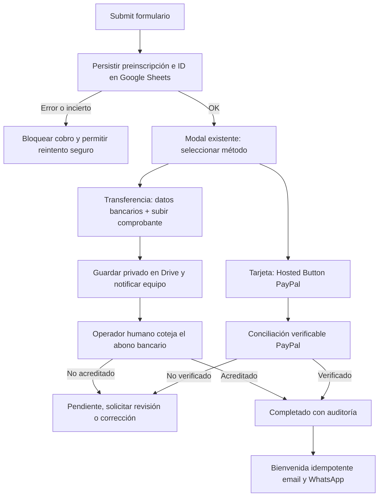
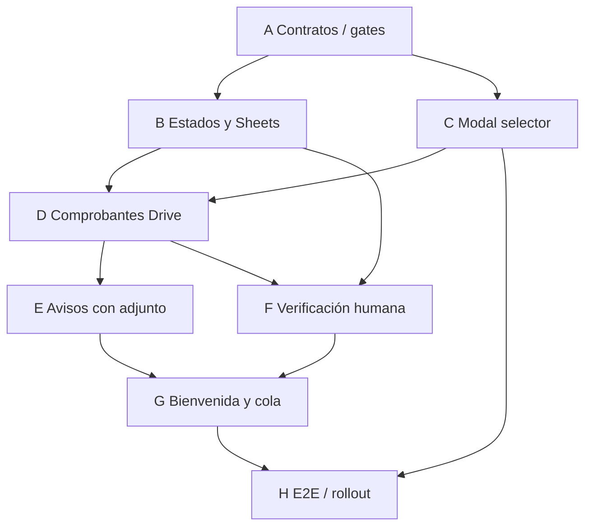

# Plan de implementación — STORYCRAFTERS: checkout por tarjeta o transferencia

**Status: reconciled — adversarial findings incorporated; product gates open**
**Fecha:** 2026-10-16
**Issue:** [#20](https://github.com/ahvega/sc-mb/issues/20)
**Especificación aprobada:** [Spec v3](../specs/2026-10-16-storycrafters-paypal-modal-spec.md), `Status: approved by owner 2026-10-16`.

> **Invariante principal:** toda transferencia debe ser verificada **manual y humanamente contra el abono bancario real**, por un operador autorizado, antes de establecer `Estatus de Pago=Completado`. Una foto, OCR, modelo o webhook no sustituyen esa aprobación. Esta regla se acordó expresamente con el propietario.

## Contexto de código y alcance

- [PR #23](https://github.com/ahvega/sc-mb/pull/23) está fusionada en `main`: modal `<dialog>`, Hosted Buttons PayPal por USD 64/72/82 e identificadores en [`docs/paypal-botones.md`](../paypal-botones.md). **Conservarlos**.
- [PR #24](https://github.com/ahvega/sc-mb/pull/24) está fusionada: `preinscripcion` en Apps Script y hojas, `Referencia de pago=PENDIENTE`, emails iniciales, bienvenida tras edición manual de referencia.
- **Brecha de seguridad existente:** la modal puede continuar al cobro incluso si falla la persistencia de la preinscripción o expira su espera. Corregir primero.
- Frontend único: `site/index.html`, `site/js/inscripcion.js`, `site/css/styles.css`. Backend: `backend/backend-inscripciones.gs`, guía `backend/LEEME.md`.
- `CLAUDE.md`: publicar `site/` mediante PR a `main` → despliegue automatizado `deploy`; **no editar `deploy`**. Apps Script requiere despliegue manual independiente. No introducir Google Forms ni grupo de `docs/PLAN-INSCRIPCION.md`.
- Antes de trabajar: verificar HEAD, PRs abiertas, configuraciones y esquema real en producción/sandbox. No duplicar cambios del otro agente.

## Entregable funcional

### Modelo de datos, estados y migración

Ampliar la hoja `Inscritos` con columnas buscadas **por encabezado** para evitar desplazar las actuales: `Registration ID`, **`Estatus de Pago`** (`Pendiente` / `Completado`), `Estado de gestión`, `Método de pago`, `Monto esperado`, `Moneda esperada`, `Referencia de pago`, `Comprobante Drive ID`, `Comprobante recibido el`, `Pago verificado el`, `Verificado por`. Conservar columnas legadas y vistas de Control/Gafetes. Agregar bitácoras `Notificaciones` (evento, registro, canal, estado, intentos) y `Auditoría` (cambio, actor, hora, justificación).

Migración **idempotente**: `Referencia de pago=PENDIENTE` implica `Pendiente`. Una referencia legada distinta **no basta automáticamente** para convertir a `Completado`: conciliar registros anteriores o dejarlos sujetos a revisión. Evitar notificaciones retroactivas duplicadas. Los cupos confirmados, Control y Gafetes deben derivarse de pagos realmente acreditados.

### Unidades de implementación

| Unidad | Objetivo y archivos | Dependencias | Evidencia de salida |
|---|---|---|---|
| **A. Contrato y configuración** | Reconciliar `main`, tarifas, Apps Script desplegado, permisos Drive/Sheets, Hosted Buttons, interfaz APIs; documentar datos bancarios autorizados, proveedor WhatsApp y operador | Spec aprobada | Tabla de contratos y configuración sin secretos, fixtures de pruebas |
| **B. Persistencia y estados** | Migrar Sheets, `registrationId`, idempotencia y error cerrado al registrar; proteger transición de estado en `backend/backend-inscripciones.gs` | A | Tests de migración, duplicados, sabotaje de inputs, fallo de Google |
| **C. Modal de elección** | Sobre el `<dialog>` existente: opciones **Tarjeta de crédito o débito** y **Transferencia**. Solo presentar Hosted Button al escoger Tarjeta; cuenta bancaria/monto correctos y selector de foto al escoger Transferencia | A, API de B estable | E2E teclado, móvil, 3 tarifas, estudiante, cambios de elección, fallos |
| **D. Comprobantes** | Validar tamaño, MIME/contenido, autorización de registro y uploads repetidos; guardar en Drive privado y vincular registro. `Pendiente` hasta acreditar | B, C | Tests de uploads maliciosos, acceso ajeno, fallos Drive, deduplicación |
| **E. Avisos a operaciones** | Email a `storycrafters@themediabuilders.com` con foto **adjunta**, ID y nombre/correo/WhatsApp, monto y acción de conciliación. WhatsApp con **medio adjunto real** vía API/BSP, o fallback **manual explícito** | D; credenciales WhatsApp para envío automático | Prueba de adjunto, mensaje/media y falla de proveedor; bitácora individual |
| **F. Verificación humana** | Acción protegida de Sheets para operador: comprobar depósito **fuera del sistema** e introducir referencia, moneda, monto, fecha, operador y confirmación expresa; bloquear API pública y transiciones no autorizadas; `onEdit` no aprueba por sí mismo | B, D | Tests de bloqueo sin operador, comprobante falso, doble aprobación, auditoría |
| **G. Bienvenida y seguimiento** | Email y WhatsApp idempotentes solo después de B/F o conciliación PayPal validada; tono de bienvenida, fecha y lugar, enlaces Google Maps/Waze, reintentos independientes por canal | E, F | Tests de duplicados, fallo parcial de canal, reintentos |
| **H. Verificación y despliegue** | E2E, seguridad, permisos, guías dueño, sandbox, compatibilidad frontend/backend y rollback | B–G | Evidencia de pruebas y checklist de salida firmado |

#### A — Contrato inicial y gates

Inventariar el `<dialog>`, `paypal.HostedButtons`, `preinscripcion`, `alEditarHoja`, columnas/órdenes de hoja, tasas USD/HNL y diferencias con Apps Script desplegado. Definir interfaz respuesta al registrar `{ok,registrationId,estatus:'Pendiente',mediosDisponibles}`. Los datos de cuenta bancaria (banco, titular, tipo/número, moneda, cuenta, instrucciones) se **aprueban por el dueño** y se sirven desde configuración de backend a la UI, nunca inventados ni publicados como secretos en una PR pública. Monto bancario se configura por tarifa: no inferir conversión del Hosted Button USD. Inspeccionar permisología y cuotas Apps Script/Drive/MailApp.

**Gate humano A1:** banco/cuenta/moneda y montos que el dueño autoriza compartir con participantes. Sin ellos, deshabilitar Transferencia con mensaje claro. **Gate externo A2:** WhatsApp Business API/BSP, emisor, destinatario y plantillas; sin ella, email automático + tarea manual de adjuntar imagen a WhatsApp, nunca falso positivo de entrega.

#### B — Preinscripción y control de estados

Guardar usando idempotency key y LockService, rechazando cambios a registros ajenos por coincidencia de correo. El resultado incierto exige consultar clave existente antes de un nuevo cobro. Si falla Sheets, **no iniciar** HostedButtons ni subida de comprobante. Validar tarifa y carné. `Estatus de Pago` inicialmente `Pendiente`. Proteger columna/acción `Completado` y evitar que un usuario público invoque `aprobarTransferencia`. Crear test que explícitamente falle si se permite la aprobación anónima. En cuenta PayPal Hosted Buttons, no interpretar cierre/retorno como captura confirmada; mantener conciliación PayPal independiente hasta disponer de API/webhook soportado y contrastado contra transacción, beneficiario, importe y moneda.

#### C — Modal

Después de submit persistido: abrir modal con 2 tarjetas/opciones; encabezado con tarifa y monto; navegabilidad por teclado, foco, Escape, cancelación y reintentos. Al seleccionar Tarjeta, montar HostedButtons **una sola vez por apertura válida**, con IDs ya documentados. Al seleccionar Transferencia, presentar datos verificados y `<input type=file>` para imagen (JPG, PNG, WebP; PDF opcional explícito). Progreso, cancelación, error y confirmación **«Comprobante recibido; pago pendiente de verificación humana»**. Evitar anunciar inscripción pagada.

#### D — Subida segura

El participante solo puede enviar a **su** registrationId mediante token no adivinable/ligado a registro, validado en servidor; limitar tamaño/MIME y verificar firma cuando sea posible; sanear nombre, evitar ejecución y tratar base64/contenido como no confiable. Guardar en carpeta Drive privada con permisos mínimos, registrar ID del objeto, hash/eventId y hora en Sheets. No almacenar base64 en celda ni exponer URL pública. Manejar fallo parcial Sheets/Drive con limpieza/reconciliación.

#### E — Notificaciones

**Email al equipo** con adjunto real y contacto, tarifa/importe, registro y texto: «Comprobante recibido, **no prueba acreditación**. Abre el banco, verifica el abono y luego usa la acción humana de confirmación en Sheets». `MailApp`/equivalente bajo cuotas y permisos. **WhatsApp al equipo** con imagen/documento y texto mediante proveedor API configurado; una URL `wa.me` solo abre un chat y **no envía adjuntos**. Sin integración, cola/panel que requiere envío humano, correo de aviso y estado `not_configured` visible. Registrar reintentos sin duplicar envíos.

#### F — Verificación por una persona

Crear comando/menú **«Confirmar transferencia verificada»** accesible a operador autorizado en la hoja; exigir que el operador marque que revisó **el movimiento en el banco**, e introduzca referencia real, fecha, monto y moneda. Verificar permisos sin asumir que `Session.getActiveUser().getEmail()` está siempre disponible; si no se puede autenticar actor, **rechazar y ofrecer entorno autenticado**. LockService y deduplicación; transición idempotente y auditada `Pendiente→Completado`, no por imagen, OCR, `onEdit` ni edición cualquiera de columna. Comprobantes falsos, ambiguos o montos divergentes siguen `Pendiente`; control de doble pago PayPal + banco.

#### G — Bienvenida

Una transición a `Completado` genera evento único por `registrationId`, con email y WhatsApp independientes `queued|sent|failed` y política de reintentos. Email HTML con botones a Google Maps/Waze y texto legible; WhatsApp con botones si proveedor admite plantillas aprobadas o enlaces en texto. Usar enlaces ya existentes del sitio y datos reales de evento (12-dic-2026); no confundir correo inicial de preinscripción con bienvenida. Reconciliación programada para mensajes pendientes, pero **nunca para aprobar transferencias**.

#### H — Validación, rollout y rollback

Pruebas locales proporcionales + navegador real escritorio/móvil: tarifas, carné, foco, selector, cancelación, guardado fallido, archivo corrupto, permisos Drive, conexión lenta, doble submit, certificado de recepción, llamada de aprobación no autorizada, referencia falsa, monto errado, doble aprobación, fallos/reintentos de MailApp/WhatsApp. Probar límites de Apps Script (tamaño POST/base64, cuotas MailApp, Drive, permisos), y fallos simultáneos. El backend debe publicarse primero en versión compatible y probado, después activar UI en `main`; nunca cambiar `deploy` a mano. Botón/feature flag de Transferencia se activa solo con datos bancarios autorizados y verificados. Documentar reversión separada de frontend y Apps Script y plan operativo de conciliación de huérfanos.

## 3. Ruta crítica y ejecución paralela

**Ruta crítica:** A → B → D → E → G → H, con F requerido antes de habilitar completado. C puede desarrollarse en paralelo a B **solo después de acordar interfaz de registro y sin editar los mismos archivos simultáneamente**. E y F pueden trabajarse en paralelo tras D, evitando modificaciones concurrentes del mismo Apps Script o coordinando por módulos aislados. Los gates A1 (cuenta), A2 (API WhatsApp) y H (despliegue/permiso) pueden retrasar lanzamiento; no saltarlos.

| Unidad | Depende de | ¿Tomar ahora? | Rol |
|---|---|---|---|
| A | Spec aprobada | Sí | Critical path |
| B | A | Tras A | Critical path |
| C | A (contrato) | Tras A, en paralelo a B | Critical parallel |
| D | B+C | Esperar | Critical path |
| E | D + A2 para auto WA | Esperar | Critical path |
| F | B+D + operador | Esperar | Critical parallel |
| G | E+F | Esperar | Downstream |
| H | B–G + gates operativos | Esperar | Release gate |

> **Descomposición:** si se emiten dos o más issues de implementación, producir y someter a revisión una guía versionada `docs/workstreams/storycrafters-pagos-ruta-critica.md` con grafo/matriz/gates antes de marcar el WorkStream listo. Hasta entonces son **unidades del plan**, no issues inventados.

## 4. Pasada adversarial requerida antes de declarar ready

**Estado real:** este plan fue redactado en la sesión principal por **GPT-6 (OpenAI)**; **no** se lanzó subagente Sol ni Astra (no hay herramientas verificadas para esos subagentes en este runtime), y **no** existe revisión externa acreditada. Solicitar desde sesión local agente adversario de **otra familia, máximo tier disponible**, idealmente Astra si efectivamente disponible; pedir revisar con contexto limpio la spec, código HEAD y este plan, priorizando: seguridad del endpoint público Apps Script, aprobación humana autenticada, adulteración de monto o registro, integridad de imágenes, permisos Drive/WhatsApp, carrera de estados, rollback, y suficiencia de pruebas; reportar hallazgos verificables por ubicación/severidad/escenario. Reconciliar hallazgos y reejecutar pruebas/documentar cambios **antes** de declarar ready.

**Triage:** `judgment — no classifier`; clase **A+B** (integración abierta + dinero/PII). Builder recomendado `maximum`; reviewer `high/maximum` adversarial y preferentemente otra familia. Builder efectivo GPT-6; reviewer aún no ejecutado. Aprobación humana Gate 1 satisfecha; **Gate de revisión técnica** pendiente. Ningún código implementado por este plan.

## Configuración temporal de cuenta bancaria para pruebas

**Decisión del propietario:** se ha facilitado una **cuenta BAC de ahorro, denominación HNL, con titular persona natural también beneficiaria**, para pruebas internas únicamente. Sus datos concretos se compartieron en conversación privada; **no copiar el número ni el nombre a repositorio público, variables versionadas, fixtures, capturas o logs**. El operador debe instalar esos datos mediante configuración no versionada y restringida (p. ej. Script Properties separadas para entorno de pruebas). La UI de pruebas podrá leerlos desde un endpoint protegido cuando corresponda; evitar exponer la cuenta en producción o staging público.

**Gate de producción obligatorio:** obtener del propietario los datos de la cuenta empresarial definitiva de **Media Builders**, reemplazar completamente la configuración de prueba, comprobar en una inspección E2E que no hay referencia a la cuenta temporal y confirmar explícitamente el beneficiario, moneda HNL, tipo y tarifas de transferencia. Registrar el resultado sin publicar números. **No fusionar activación de transferencias reales sin superar este gate.** La aprobación de los comprobantes sigue siendo exclusivamente humana y manual tras comprobar el abono bancario.

## 5. Reconciliación adversarial — decisión final del plan (16-oct-2026)

**Fuentes realmente verificadas:** [revisión Devin/SWE (F1–F11)](https://github.com/ahvega/sc-mb/pull/27#pullrequestreview-5553716986) y [revisión Codex/GPT-6 (R1–R7)](https://github.com/ahvega/sc-mb/pull/27#issuecomment-6224876866). No hay revisión firmada explícitamente por Astra visible en la conversación de PR consultada; no atribuirle hallazgos. Ambos revisores señalaron problemas de diseño, **no** fallos reproducidos en producción. **18 observaciones incorporadas** en el contrato de ejecución siguiente; F10/F11 son mejoras no bloqueantes, R7 corrección documental.

### 5.1 Decisiones normativas que sustituyen propuestas ambiguas de las unidades A–H

**R1 + F1 — Un único dueño de notificaciones, outbox real y entrega desconocida (B/E/G/H; bloqueante).**
- El único emisor de bienvenida será un worker de `Notificaciones` disparado por la transición de pago verificada. Retirar/reencaminar `procesarPagoVerificado` y `alEditarHoja`: **no pueden enviar bienvenida directamente**. Eliminar posibilidad de un segundo emisor desde ruta legacy.
- Modelo de salida: `eventKey=registrationId:paymentCompletionVersion:channel:templateVersion`, `queued / claimed / sent / failed / delivery_unknown`, timestamp, lease del worker, intentos, `providerMessageId` si existe y política de recuperación. Crear/reparar eventos faltantes a partir de `Completado` mediante reconciliador que **no vuelve a aprobar** pagos. Sembrar el historial a partir de `Correo enviado` legada para prevenir reenvíos históricos.
- Si el proveedor acepta el envío y se pierde el ACK, **no reintentar ciegamente**: consultar acuse/estado del proveedor si es posible; de lo contrario `delivery_unknown`, revisión operativa y resolución explícita. MailApp carece de garantía de envío exactamente una vez; **objetivo real: eventos únicos + recuperación y deduplicación best-effort con excepción visible**, no promesa falsa de entrega exactly once.
- Pruebas: doble trigger heredado, caída entre cambio de estado/encolado, caída tras aceptación/antes de `sent`, workers concurrentes, email OK/WA fallido, reconciliación sin duplicar.

**R2 — Intentos de pago y cambio seguro de método (B/C/F; bloqueante).**
- Persistir `Intentos de Pago`: identificador, registro, método, estado `selected / launched / in_progress / unknown / verified / definitively_failed / cancelled_confirmed`, hora, evidencia y operador de conciliación. La transición a `launched` ocurre **antes de exponer/invocar el Hosted Button**; dado que un Hosted Button no emite un callback confiable de cancelación, después de lanzarlo el servidor debe asumir estado **unknown** hasta verificación/operador.
- La UI ofrece ambos métodos en un registro **sin intentos activos**. Una vez iniciado PayPal, impedir desde servidor cambiar a transferencia/cargar comprobante o volver a cobrar hasta resolución humana de intento potencialmente cobrado. Cerrar modal, recargar o abrir segunda pestaña **no desbloquea**. Si el lanzamiento falló antes de abrir PayPal con evidencia verificable, reactivar de forma segura.
- Un cargo PayPal tardío luego de acreditación bancaria se anota como **segundo settlement/disputa** para conciliación/devolución humana, no sobrescribe la primera referencia ni envía otra bienvenida. Pruebas multi-tab, cerrar/reabrir, checkout todavía abierto, settle tardío y carrera.

**R3 + F7 — Arquitectura administrativa auténtica y una autoridad de transición (A/B/F/H; bloqueante).**
- **Decisión arquitectónica:** mantener backend público Apps Script independiente **solo para preinscripción/subida**, y crear una **interfaz administrativa separada** (proyecto vinculado a la hoja, menú/diálogo o servicio interno) que **no contenga credenciales ni acción de aprobación accesible desde el endpoint público**. La escritura final del estado deberá ejecutarse en **una autoridad serializada única**. Un `ScriptLock` de dos proyectos distintos **no es lock compartido**. Evitar que dos proyectos muten concurrentemente referencias/estados: elegir un único proyecto propietario de los cambios de pago, o introducir un almacenamiento/servicio de mutación transaccional compartido; no declararlo resuelto solo instalando ambos scripts.
- Menú `Confirmar pago verificado` para **transferencias y PayPal**, que exige identidad autenticada y allowlist real de operadores. Si identidad humana no está disponible (`Session.getActiveUser()`, `e.user` pueden ser vacíos o engañosos), **rechazar**, sin imputar la identidad del instalador. Proteger hoja/columnas contra cambios directos; `onEdit` no acreditará ni enviará: registra intento de edición fuera de procedimiento para revisión/reversión. Ningún `doPost` público puede aprobar pagos.
- La unidad A debe cerrar con un **ADR administrativo** que especifique proyecto propietario de mutaciones, instalación real de menú vinculado, credenciales, permisos Drive/Sheets, allowlist, origen de identidad y punto único de serialización **antes de programar B/F**. Probar editor no autorizado, llamada anónima y carreras admin/backend.

**R4 + F4 — Libro de acreditaciones y asociación verificable (B/F; bloqueante).**
- Crear ledger `Acreditaciones`: `settlementKey` **único global** por método+cuenta receptora+identificador de movimiento/txn PayPal, importe, moneda, fecha, evidencia, `registrationId`, actor y estado. Bajo la misma autoridad de serialización, **reservar/consumir settlementKey una sola vez en todas las inscripciones**, y reconciliar escrituras parciales mediante estado intermedio verificable. Fotos iguales o transformadas no son claves de settlement.
- Verificación PayPal también requiere **aprobación operativa auditable** mientras Hosted Buttons no suministren enlace de pedido confiable: el operador contrasta `transactionId`, pagador, cuenta, importe USD, moneda, hora y registro; coincidencia de correo no es suficiente. No marcar completado ante empate ambiguo; registrar como pago huérfano e investigar.
- Verificación de transferencia sigue **exclusivamente manual y humana contra movimientos bancarios reales**; comprobante/IA/OCR/webhook jamás la aprueban. Exigir referencia y actor verificado, no solo cambiar `Referencia de pago` en la celda. Tests reutilización de crédito en 2 inscripciones, imágenes recortadas, dos operadores, crash parcial y asignación ambigua PayPal.

**R5 — Límite real de Hosted Buttons públicos (A/C/H; gate de producto bloqueante para prometer la invariante absoluta).**
- Los 3 links Hosted Buttons son reutilizables fuera de la landing, incluso por usuarios **sin inscripción**. Bloquear la UI al fallar `preinscripcion` previene *el camino normal*, **pero no garantiza globalmente “ningún cobro sin registro”**.
- **Gate de decisión dueño/PayPal antes de declarar listo para producción:** probar en Sandbox el link copiado, revisar con proveedor si admite requisito de registro/metadata verificable. Si no lo admite, **(i)** migrar el cobro a órdenes PayPal creadas servidor con `registrationId` verificado, preservando modal de elección y UX, **o (ii)** documentar/aceptar explícitamente la excepción de cobros huérfanos externos con cola de conciliación y procedimiento de reembolso. La opción (ii) **no satisface** el invariante absoluto y no podrá anunciarse como tal. No reemplazar Hosted Buttons sin decisión aprobada de dueño y plan de regresión.
- Crear registro de pagos huérfanos y playbook de soporte, y probar acceso al enlace directo sin registro.

**R6 + F11 — Control de abuso y presupuestos (A/B/D/E/H; gate de producción).**
- Proteger preinscripciones/subidas públicas con rate limit por entidad e IP/gateway confiable (no confiar en IP aportada por cliente), challenge/confirmación de contacto cuando sea necesario, expiración de tokens y topes globales y por registro en cantidad de archivos, bytes, intentos, mensajes y costo de proveedor. Antes de Drive o encolar emails/WA verificar cuota y saldo de presupuesto; reservar capacidad de mensajes para pagos confirmados, registrar denegaciones y circuit breaker con alerta.
- Determinar **límites y cuotas vigentes del entorno real** para MailApp/Apps Script/Drive/WA (no fijar un “25 MB” como constante universal sin comprobar), y testear ráfagas distribuidas, muchas cuentas nuevas, archivos distintos y retry storms; rechazos no consumen espacio ni notifican.

**F2 — Separación estricta de cuenta de pruebas (A/C/H; bloqueante).**
- Banco BAC temporal: **solo entorno sandbox restringido**, en Script Properties de proyecto/despliegue separado del de producción, no en `main`, HTML publicado, frontend de producción, PR ni logs. No es suficiente un `doGet` “protegido” en una web app pública: separar entornos y exigir token de preinscripción con vigencia/autoridad antes de devolver cuenta y monto. Feature flag `TRANSFERENCIAS_PRUEBA` adicional no reemplaza separación física/lógica.
- Publicación de cuenta real de Media Builders, importe HNL por tarifa y autorización del dueño son gates; verificar que ningún bundle/endpoint público de producción exponga la cuenta personal temporal.

**F3 — Capability segura de upload (B/D; bloqueante).**
- `registrationId` UUID no secuencial **no sustituye** autenticación. Crear token aleatorio de subida distinto del ID y secreto en servidor (almacenar hash), ligado a registro y alcance, con expiración, un uso o renovaciones controladas. No numerar filas como credencial. Solo permitir subir/reemplazar con validación de estado, límite de reemplazos y acción explícita para habilitar reenvío; no filtrar tokens en links/logs/hojas visibles. Validar ownership, MIME real, dimensiones y bytes en backend.

**F5 — Estudiantes: consumo real de código (B/F; criterio de aceptación).**
- Persistir vínculo entre `registrationId`, código de estudiante y fila de aprobación. En confirmación humana de **cualquier** método, marcar `Estudiantes: Pagado (referencia)` y consumir uso una sola vez, con locking; prohibir reutilización del código desde otra sesión, tabs o intento de pago. Pruebas de cupón reutilizado, cambio de método y doble confirmación.

**F6 — Política explícita de cupos (A/B/F; gate del dueño).**
- Propuesta conservadora hasta decisión final: **`Pendiente`, incluido `Comprobante recibido`, NO reserva cupo**. Al aprobar humano, verificar cupo aún disponible bajo lock; si ya está lleno, registrar `Pago recibido — cupo no disponible`, escalar devolución/alternativa, **no** emitir bienvenida ni contar asiento. Mostrar advertencia antes de iniciar transferencia. Para reserva temporal, exigir nueva decisión de dueño que defina TTL/cupo reservado y escenario sobreventa; no inventarlo tácitamente.

**F8 — Retirar ruta legacy de aprobación (B/C; bloqueante).**
- Deshabilitar permanentemente flujo alternativo `paypal.Buttons` + `doPost` que escribe referencia real/manda confirmación directamente; o enrutarlo completamente al mismo ledger y transición validada. Test negativo: quitar `data-paypal-botones` o agregar `data-paypal-client-id` **no** puede reactivar cobro que omita registro/estados.

**F9 — Instrucciones bancarias persistentes al participante (C/E; obligatorio).**
- Tras seleccionar Transferencia, enviar **correo al participante** con datos bancarios autorizados, importe HNL, moneda, referencia y procedimiento para comprobante, para que no desaparezcan al cerrar modal. WhatsApp saliente solo si proveedor autorizado/plantilla; en ausencia ofrecer enlace manual y registrar entrega no efectuada. No enviar información de banco temporal a participantes reales en entorno de producción.

**F10 — Reutilización controlada de conversión de imagen (D; mejora).**
- Reusar donde sea apropiado `prepararArchivo` del carné (redimensión JPEG/6 MB del cliente) pero aislar comprobantes, aplicar validación real también en servidor, preservar legibilidad de texto y permitir alternativas cuando el recorte degrade la evidencia. No confiar en canvas/MIME del cliente.

**R7 — Corrección de checklist (spec/H).**
- Criterio inequívoco: **transferencia solo se aprueba manualmente por humano autorizado**; incluso OCR perfecto, imagen realista, API bancaria o webhook no pueden finalizar pago automáticamente. Automatización PayPal verificada es distinta y solo después de compatibilidad real y decisión del dueño.

### 5.2 Contratos y gates de entrega ejecutables

| Gate | Requisito verificable | Responsable | Si falla |
|---|---|---|---|
| G0 — arquitectura | ADR firmado: una autoridad de mutación, admin autenticado, Hosted Buttons y estrategia de enlaces huérfanos | Arquitecto + dueño | No iniciar B/F |
| G1 — pagos | Sheets guarda antes de modal; intentos bloquean cambio inseguro; ledger evita acreditación cruzada; legacy anulada | Backend + QA | No cobrar |
| G2 — privacidad | Cuenta BAC pruebas aislada, número/titular ausentes de código/producción, upload capabilities seguras, Drive privado | Seguridad + dueño | No habilitar Transferencia |
| G3 — humano | Cotejo bancario externo + operador autenticado; no automatización de transferencias; auditoría obligatoria | Operador + QA | Seguir Pendiente |
| G4 — mensajería | Emisor único + outbox, `delivery_unknown`, adjunto email y media WhatsApp si realmente configurada; mensaje al participante | Backend + Operaciones | No afirmar envío |
| G5 — release | Pruebas técnicas y de cuotas, errores, cupos, estudiantes, rollback y migración; cuenta Media Builders final | QA + dueño | Mantener flag apagado |

**Trazabilidad de revisiones (ledger):**

| Hallazgo | Resolución aceptada | Etapa |
|---|---|---|
| Devin F1 | Redirigir antiguo emisor; outbox dueño único | B/G |
| Devin F2 | Ambientes separados, no endpoint público “protegido” ficticio | A/H |
| Devin F3 | Token de carga aleatorio vinculado al registro | B/D |
| Devin F4 | Ledger, conciliación humana PayPal con evidencia | B/F |
| Devin F5 | Consumir código estudiantil al acreditar | B/F |
| Devin F6 | Pendiente no reserva cupo, decisión del dueño | A/B/F |
| Devin F7 | Acción admin protegida y bloquear onEdit como aprobación | F |
| Devin F8 | Eliminar/encaminar ruta legacy | B/C |
| Devin F9 | Email de instrucciones bancarias al participante | E |
| Devin F10 | Reutilizar pipeline de fotos con validación servidor | D |
| Devin F11 | Límites vigentes y pruebas explícitas de cuotas | H |
| Codex R1 | Outbox recuperable, estado `delivery_unknown` | E/G |
| Codex R2 | Intentos de pago, bloqueo de segundo método | B/C |
| Codex R3 | Proyecto admin vinculado + autoridad serial única, ADR obligatorio | A/F |
| Codex R4 | SettlementKey único global | B/F |
| Codex R5 | Gate capacidad Hosted Buttons; aceptar excepción o cambiar modalidad | A/H |
| Codex R6 | Throttling y presupuestos agregados | A/D/E |
| Codex R7 | Corregir condición de aceptación bancaria humana | Spec/H |

**Estado del plan tras reconciliación:** `reconciled — design ready for implementation planning, with owner/product gates G0/G2/G5 unresolved`. Esta revisión documental **no equivale** a pruebas E2E ni a aprobación de lanzamiento. No adjudica ninguna revisión al modelo Astra sin evidencia. No implementar pagos en producción mientras los gates sigan abiertos.
