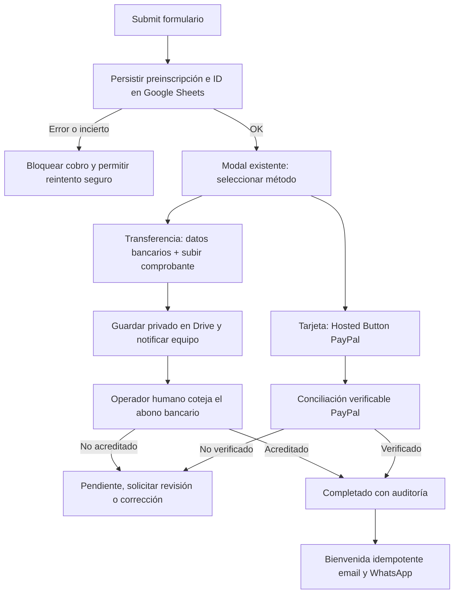
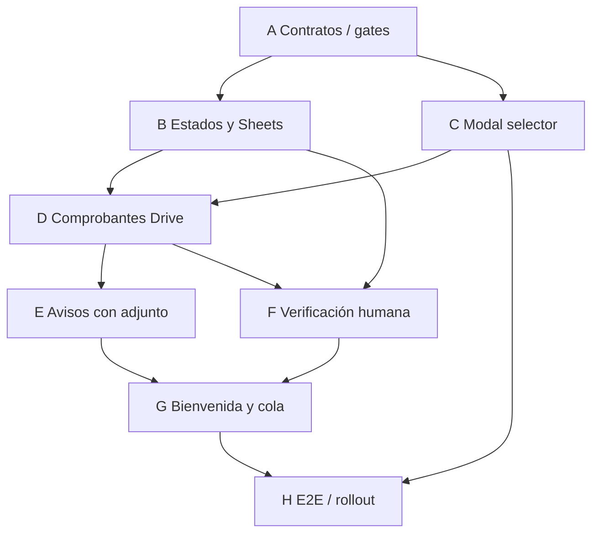

# Plan de implementación — STORYCRAFTERS: checkout por tarjeta o transferencia

**Status: draft — pending independent adversarial review**
**Fecha:** 2026-10-16
**Issue:** [#20](https://github.com/ahvega/sc-mb/issues/20)
**Especificación aprobada:** [Spec v3](../specs/2026-10-16-storycrafters-paypal-modal-spec.md), `Status: approved by owner 2026-10-16`.

> **Invariante principal:** toda transferencia debe ser verificada **manual y humanamente contra el abono bancario real**, por un operador autorizado, antes de establecer `Estatus de Pago=Completado`. Una foto, OCR, modelo o webhook no sustituyen esa aprobación. Esta regla se acordó expresamente con el propietario.

## Contexto de código y alcance

- [PR #23](https://github.com/ahvega/sc-mb/pull/23) está fusionada en `main`: modal `<dialog>`, Hosted Buttons PayPal por USD 64/72/82 e identificadores en [`docs/paypal-botones.md`](../paypal-botones.md). **Conservarlos**.
- [PR #24](https://github.com/ahvega/sc-mb/pull/24) está fusionada: `preinscripcion` en Apps Script y hojas, `Referencia de pago=PENDIENTE`, emails iniciales, bienvenida tras edición manual de referencia.
- **Brecha de seguridad existente:** la modal puede continuar al cobro incluso si falla la persistencia de la preinscripción o expira su espera. Corregir primero.
- Frontend único: `site/index.html`, `site/js/inscripcion.js`, `site/css/styles.css`. Backend: `backend/backend-inscripciones.gs`, guía `backend/LEEME.md`.
- `CLAUDE.md`: publicar `site/` mediante PR a `main` → despliegue automatizado `deploy`; **no editar `deploy`**. Apps Script requiere despliegue manual independiente. No introducir Google Forms ni grupo de `docs/PLAN-INSCRIPCION.md`.
- Antes de trabajar: verificar HEAD, PRs abiertas, configuraciones y esquema real en producción/sandbox. No duplicar cambios del otro agente.

## Entregable funcional

### Modelo de datos, estados y migración

Ampliar la hoja `Inscritos` con columnas buscadas **por encabezado** para evitar desplazar las actuales: `Registration ID`, **`Estatus de Pago`** (`Pendiente` / `Completado`), `Estado de gestión`, `Método de pago`, `Monto esperado`, `Moneda esperada`, `Referencia de pago`, `Comprobante Drive ID`, `Comprobante recibido el`, `Pago verificado el`, `Verificado por`. Conservar columnas legadas y vistas de Control/Gafetes. Agregar bitácoras `Notificaciones` (evento, registro, canal, estado, intentos) y `Auditoría` (cambio, actor, hora, justificación).

Migración **idempotente**: `Referencia de pago=PENDIENTE` implica `Pendiente`. Una referencia legada distinta **no basta automáticamente** para convertir a `Completado`: conciliar registros anteriores o dejarlos sujetos a revisión. Evitar notificaciones retroactivas duplicadas. Los cupos confirmados, Control y Gafetes deben derivarse de pagos realmente acreditados.

### Unidades de implementación

| Unidad | Objetivo y archivos | Dependencias | Evidencia de salida |
|---|---|---|---|
| **A. Contrato y configuración** | Reconciliar `main`, tarifas, Apps Script desplegado, permisos Drive/Sheets, Hosted Buttons, interfaz APIs; documentar datos bancarios autorizados, proveedor WhatsApp y operador | Spec aprobada | Tabla de contratos y configuración sin secretos, fixtures de pruebas |
| **B. Persistencia y estados** | Migrar Sheets, `registrationId`, idempotencia y error cerrado al registrar; proteger transición de estado en `backend/backend-inscripciones.gs` | A | Tests de migración, duplicados, sabotaje de inputs, fallo de Google |
| **C. Modal de elección** | Sobre el `<dialog>` existente: opciones **Tarjeta de crédito o débito** y **Transferencia**. Solo presentar Hosted Button al escoger Tarjeta; cuenta bancaria/monto correctos y selector de foto al escoger Transferencia | A, API de B estable | E2E teclado, móvil, 3 tarifas, estudiante, cambios de elección, fallos |
| **D. Comprobantes** | Validar tamaño, MIME/contenido, autorización de registro y uploads repetidos; guardar en Drive privado y vincular registro. `Pendiente` hasta acreditar | B, C | Tests de uploads maliciosos, acceso ajeno, fallos Drive, deduplicación |
| **E. Avisos a operaciones** | Email a `storycrafters@themediabuilders.com` con foto **adjunta**, ID y nombre/correo/WhatsApp, monto y acción de conciliación. WhatsApp con **medio adjunto real** vía API/BSP, o fallback **manual explícito** | D; credenciales WhatsApp para envío automático | Prueba de adjunto, mensaje/media y falla de proveedor; bitácora individual |
| **F. Verificación humana** | Acción protegida de Sheets para operador: comprobar depósito **fuera del sistema** e introducir referencia, moneda, monto, fecha, operador y confirmación expresa; bloquear API pública y transiciones no autorizadas; `onEdit` no aprueba por sí mismo | B, D | Tests de bloqueo sin operador, comprobante falso, doble aprobación, auditoría |
| **G. Bienvenida y seguimiento** | Email y WhatsApp idempotentes solo después de B/F o conciliación PayPal validada; tono de bienvenida, fecha y lugar, enlaces Google Maps/Waze, reintentos independientes por canal | E, F | Tests de duplicados, fallo parcial de canal, reintentos |
| **H. Verificación y despliegue** | E2E, seguridad, permisos, guías dueño, sandbox, compatibilidad frontend/backend y rollback | B–G | Evidencia de pruebas y checklist de salida firmado |

#### A — Contrato inicial y gates

Inventariar el `<dialog>`, `paypal.HostedButtons`, `preinscripcion`, `alEditarHoja`, columnas/órdenes de hoja, tasas USD/HNL y diferencias con Apps Script desplegado. Definir interfaz respuesta al registrar `{ok,registrationId,estatus:'Pendiente',mediosDisponibles}`. Los datos de cuenta bancaria (banco, titular, tipo/número, moneda, cuenta, instrucciones) se **aprueban por el dueño** y se sirven desde configuración de backend a la UI, nunca inventados ni publicados como secretos en una PR pública. Monto bancario se configura por tarifa: no inferir conversión del Hosted Button USD. Inspeccionar permisología y cuotas Apps Script/Drive/MailApp.

**Gate humano A1:** banco/cuenta/moneda y montos que el dueño autoriza compartir con participantes. Sin ellos, deshabilitar Transferencia con mensaje claro. **Gate externo A2:** WhatsApp Business API/BSP, emisor, destinatario y plantillas; sin ella, email automático + tarea manual de adjuntar imagen a WhatsApp, nunca falso positivo de entrega.

#### B — Preinscripción y control de estados

Guardar usando idempotency key y LockService, rechazando cambios a registros ajenos por coincidencia de correo. El resultado incierto exige consultar clave existente antes de un nuevo cobro. Si falla Sheets, **no iniciar** HostedButtons ni subida de comprobante. Validar tarifa y carné. `Estatus de Pago` inicialmente `Pendiente`. Proteger columna/acción `Completado` y evitar que un usuario público invoque `aprobarTransferencia`. Crear test que explícitamente falle si se permite la aprobación anónima. En cuenta PayPal Hosted Buttons, no interpretar cierre/retorno como captura confirmada; mantener conciliación PayPal independiente hasta disponer de API/webhook soportado y contrastado contra transacción, beneficiario, importe y moneda.

#### C — Modal

Después de submit persistido: abrir modal con 2 tarjetas/opciones; encabezado con tarifa y monto; navegabilidad por teclado, foco, Escape, cancelación y reintentos. Al seleccionar Tarjeta, montar HostedButtons **una sola vez por apertura válida**, con IDs ya documentados. Al seleccionar Transferencia, presentar datos verificados y `<input type=file>` para imagen (JPG, PNG, WebP; PDF opcional explícito). Progreso, cancelación, error y confirmación **«Comprobante recibido; pago pendiente de verificación humana»**. Evitar anunciar inscripción pagada.

#### D — Subida segura

El participante solo puede enviar a **su** registrationId mediante token no adivinable/ligado a registro, validado en servidor; limitar tamaño/MIME y verificar firma cuando sea posible; sanear nombre, evitar ejecución y tratar base64/contenido como no confiable. Guardar en carpeta Drive privada con permisos mínimos, registrar ID del objeto, hash/eventId y hora en Sheets. No almacenar base64 en celda ni exponer URL pública. Manejar fallo parcial Sheets/Drive con limpieza/reconciliación.

#### E — Notificaciones

**Email al equipo** con adjunto real y contacto, tarifa/importe, registro y texto: «Comprobante recibido, **no prueba acreditación**. Abre el banco, verifica el abono y luego usa la acción humana de confirmación en Sheets». `MailApp`/equivalente bajo cuotas y permisos. **WhatsApp al equipo** con imagen/documento y texto mediante proveedor API configurado; una URL `wa.me` solo abre un chat y **no envía adjuntos**. Sin integración, cola/panel que requiere envío humano, correo de aviso y estado `not_configured` visible. Registrar reintentos sin duplicar envíos.

#### F — Verificación por una persona

Crear comando/menú **«Confirmar transferencia verificada»** accesible a operador autorizado en la hoja; exigir que el operador marque que revisó **el movimiento en el banco**, e introduzca referencia real, fecha, monto y moneda. Verificar permisos sin asumir que `Session.getActiveUser().getEmail()` está siempre disponible; si no se puede autenticar actor, **rechazar y ofrecer entorno autenticado**. LockService y deduplicación; transición idempotente y auditada `Pendiente→Completado`, no por imagen, OCR, `onEdit` ni edición cualquiera de columna. Comprobantes falsos, ambiguos o montos divergentes siguen `Pendiente`; control de doble pago PayPal + banco.

#### G — Bienvenida

Una transición a `Completado` genera evento único por `registrationId`, con email y WhatsApp independientes `queued|sent|failed` y política de reintentos. Email HTML con botones a Google Maps/Waze y texto legible; WhatsApp con botones si proveedor admite plantillas aprobadas o enlaces en texto. Usar enlaces ya existentes del sitio y datos reales de evento (12-dic-2026); no confundir correo inicial de preinscripción con bienvenida. Reconciliación programada para mensajes pendientes, pero **nunca para aprobar transferencias**.

#### H — Validación, rollout y rollback

Pruebas locales proporcionales + navegador real escritorio/móvil: tarifas, carné, foco, selector, cancelación, guardado fallido, archivo corrupto, permisos Drive, conexión lenta, doble submit, certificado de recepción, llamada de aprobación no autorizada, referencia falsa, monto errado, doble aprobación, fallos/reintentos de MailApp/WhatsApp. Probar límites de Apps Script (tamaño POST/base64, cuotas MailApp, Drive, permisos), y fallos simultáneos. El backend debe publicarse primero en versión compatible y probado, después activar UI en `main`; nunca cambiar `deploy` a mano. Botón/feature flag de Transferencia se activa solo con datos bancarios autorizados y verificados. Documentar reversión separada de frontend y Apps Script y plan operativo de conciliación de huérfanos.

## 3. Ruta crítica y ejecución paralela

**Ruta crítica:** A → B → D → E → G → H, con F requerido antes de habilitar completado. C puede desarrollarse en paralelo a B **solo después de acordar interfaz de registro y sin editar los mismos archivos simultáneamente**. E y F pueden trabajarse en paralelo tras D, evitando modificaciones concurrentes del mismo Apps Script o coordinando por módulos aislados. Los gates A1 (cuenta), A2 (API WhatsApp) y H (despliegue/permiso) pueden retrasar lanzamiento; no saltarlos.

| Unidad | Depende de | ¿Tomar ahora? | Rol |
|---|---|---|---|
| A | Spec aprobada | Sí | Critical path |
| B | A | Tras A | Critical path |
| C | A (contrato) | Tras A, en paralelo a B | Critical parallel |
| D | B+C | Esperar | Critical path |
| E | D + A2 para auto WA | Esperar | Critical path |
| F | B+D + operador | Esperar | Critical parallel |
| G | E+F | Esperar | Downstream |
| H | B–G + gates operativos | Esperar | Release gate |

> **Descomposición:** si se emiten dos o más issues de implementación, producir y someter a revisión una guía versionada `docs/workstreams/storycrafters-pagos-ruta-critica.md` con grafo/matriz/gates antes de marcar el WorkStream listo. Hasta entonces son **unidades del plan**, no issues inventados.

## 4. Pasada adversarial requerida antes de declarar ready

**Estado real:** este plan fue redactado en la sesión principal por **GPT-6 (OpenAI)**; **no** se lanzó subagente Sol ni Astra (no hay herramientas verificadas para esos subagentes en este runtime), y **no** existe revisión externa acreditada. Solicitar desde sesión local agente adversario de **otra familia, máximo tier disponible**, idealmente Astra si efectivamente disponible; pedir revisar con contexto limpio la spec, código HEAD y este plan, priorizando: seguridad del endpoint público Apps Script, aprobación humana autenticada, adulteración de monto o registro, integridad de imágenes, permisos Drive/WhatsApp, carrera de estados, rollback, y suficiencia de pruebas; reportar hallazgos verificables por ubicación/severidad/escenario. Reconciliar hallazgos y reejecutar pruebas/documentar cambios **antes** de declarar ready.

**Triage:** `judgment — no classifier`; clase **A+B** (integración abierta + dinero/PII). Builder recomendado `maximum`; reviewer `high/maximum` adversarial y preferentemente otra familia. Builder efectivo GPT-6; reviewer aún no ejecutado. Aprobación humana Gate 1 satisfecha; **Gate de revisión técnica** pendiente. Ningún código implementado por este plan.

## Configuración temporal de cuenta bancaria para pruebas

**Decisión del propietario:** se ha facilitado una **cuenta BAC de ahorro, denominación HNL, con titular persona natural también beneficiaria**, para pruebas internas únicamente. Sus datos concretos se compartieron en conversación privada; **no copiar el número ni el nombre a repositorio público, variables versionadas, fixtures, capturas o logs**. El operador debe instalar esos datos mediante configuración no versionada y restringida (p. ej. Script Properties separadas para entorno de pruebas). La UI de pruebas podrá leerlos desde un endpoint protegido cuando corresponda; evitar exponer la cuenta en producción o staging público.

**Gate de producción obligatorio:** obtener del propietario los datos de la cuenta empresarial definitiva de **Media Builders**, reemplazar completamente la configuración de prueba, comprobar en una inspección E2E que no hay referencia a la cuenta temporal y confirmar explícitamente el beneficiario, moneda HNL, tipo y tarifas de transferencia. Registrar el resultado sin publicar números. **No fusionar activación de transferencias reales sin superar este gate.** La aprobación de los comprobantes sigue siendo exclusivamente humana y manual tras comprobar el abono bancario.
