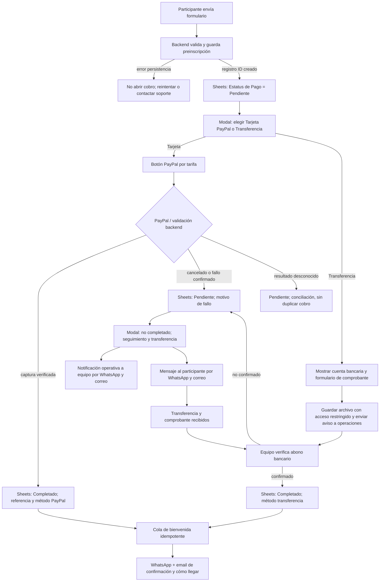

# STORYCRAFTERS — Spec v3: inscripción, cobro PayPal, recuperación bancaria y comunicaciones

**Issue:** [ahvega/sc-mb#20](https://github.com/ahvega/sc-mb/issues/20)  
**Fecha:** 2026-10-16  
**Status: approved by owner 2026-10-16** (Gate 1; aprobación explícita en conversación, verificación humana de comprobantes obligatoria)  
**Naturaleza:** especificación propuesta, no es plan ni autorización para desplegar pagos en producción.

## 1. Objetivo y fuente de verdad

Registrar a cada participante **antes de iniciar el cobro**, con una fila trazable en Google Sheets; abrir el modal existente con dos opciones de pago — **Tarjeta de crédito o débito (PayPal)** y **Transferencia bancaria** — para la tarifa que corresponde; acreditar el éxito solo tras verificación; y manejar pagos no completados con seguimiento por WhatsApp/correo y una alternativa de transferencia bancaria. Al acreditar **cualquier** modalidad, enviar bienvenida una sola vez por correo y WhatsApp, con direcciones al evento.

**Terminología explícita:** `Estatus de Pago` = `Pendiente` | `Completado` (valores solicitados). Un campo distinto, **`Estado de gestión`**, distingue `Pago PayPal en curso`, `Fallo confirmado`, `Cancelado`, `Verificación pendiente`, `Transferencia solicitada`, `Comprobante recibido`, `Verificación bancaria pendiente` y `Resuelto`. La columna de pago jamás se marca `Completado` por un callback del navegador, captura no verificada o comprobante sin conciliar. No se usa `Fallido` como estatus de pago: queda `Pendiente`, con motivo en `Estado de gestión`.

## 2. Contexto real del repo y conflicto de trabajos paralelos

- `site/index.html` tiene tarifas generales Preventa L 1,700, Regular L 1,900, Finales L 2,200 y Estudiante L 1,700, formulario de inscripción, y `#insc` con configuración inicial vacía.
- `site/js/inscripcion.js` contiene un flujo anterior de PayPal SDK / orden/captura y Google Apps Script.
- `backend/backend-inscripciones.gs` maneja inscripciones, cupos, revisión de carné y hojas. `backend/LEEME.md` explica su instalación manual.
- `docs/PLAN-INSCRIPCION.md` es un plan anterior (Google Forms + enlaces, grupos) **no vinculante** si contradice el flujo actual.
- **Trabajo del otro agente ya fusionado:** `docs/paypal-botones.md` documenta Hosted Buttons USD 64/72/82 y PR #23 incorporó la modal PayPal; no recrear.
- **PR #24 fusionada a `main` el 16-oct-2026: [#24 — Guardar los datos del formulario en la hoja antes del pago](https://github.com/ahvega/sc-mb/pull/24).** Su descripción propone una acción `preinscripcion`, filas con `Referencia de pago=PENDIENTE` y excluir pendientes de cupos. También indica que la ventana de pago se abre **aunque falle guardar la preinscripción**; esto **no satisface** el requisito de vinculación inmutable: debe cambiarse a fallo cerrado antes del cobro, o acordarse y verificar una alternativa duradera equivalente. **No editar los mismos archivos en paralelo ni duplicar la PR #24.** La fusión fue verificada mediante el historial de `main`.

### Contrato de coordinación

1. Antes de implementar, `git fetch` y revisar **PRs abiertas/recientemente fusionadas, issues, `site/index.html`, `site/js/inscripcion.js`, `backend/backend-inscripciones.gs`, documentación PayPal** y posibles nuevas ramas. Registrar qué agente es dueño de los botones/modal y cuál del backend/notificaciones; no reclamar ni modificar archivos que ese agente esté editando sin coordinación.
2. **Consumir** el MD de snippets como fuente de configuración, no como permiso para inyectar HTML/JS remoto sin validación, ni como prueba de cobro. Los identificadores, importes y moneda deben corresponder a la tarifa validada por servidor; verificar vigencia, URL oficial y beneficiario.
3. Si el otro agente **ya integra el modal**, hacer review y cubrir solo las brechas (persistencia, estados, notificaciones, transferencia, conciliación, seguridad). Evitar un modal o un handler de pago duplicados.
4. El trabajo sobre Google Sheets y notificaciones debe basarse en el esquema **real después de fusionar #24**; añadir la columna `Estatus de Pago` y campos nuevos mediante **migración compatible**, no desplazar columnas fijas silenciosamente. Las filas `PENDIENTE` existentes deben migrarse sin convertirse en pagos reales.
5. Integración secuencial con PRs pequeñas y pruebas de regresión; los cambios al backend Apps Script no se despliegan automáticamente al publicar `site/`.

## 3. Flujo funcional

## 3.0 Decisión de producto actualizada — selector de pago al enviar datos (16-oct-2026)

**Este apartado prevalece ante cualquier descripción anterior que limite la transferencia a un fallback después de fallar PayPal.** La transferencia es un método primario disponible desde el primer momento, sin intentar PayPal. Esta especificación está **aprobada para planificar**, pero no habilita cobros reales ni sustituye los gates operativos de configuración.

1. Tras pulsar **Enviar inscripción**, validar y **persistir** datos en Google Sheets (`registrationId` único, `Estatus de Pago=Pendiente`, tarifa y monto validados). Si no se confirma la persistencia, **no** abrir un proceso de cobro ni permitir subida de comprobante; mostrar error recuperable.
2. Mostrar la **modal actual** (`<dialog>`), adaptada con dos opciones mutuamente excluyentes y reversibles: **(A) Tarjeta de crédito o débito (pagar con PayPal)** y **(B) Transferencia bancaria**. Mostrar tarifa, monto exigible, moneda, titular y advertencia de que el cupo se confirma tras verificar fondos; conservar cierre y accesibilidad por teclado/foco. No crear otra modal.
3. Si elige **A**, presentar dentro de la modal el `HostedButtons` que ya corresponde a la tarifa según [`docs/paypal-botones.md`](../../paypal-botones.md); no recrear botones ni tratar la apertura del link/retorno como pago completado.
4. Si elige **B**, mostrar **datos bancarios oficiales de Media Builders** previamente aprobados por el dueño (banco, beneficiario, número y tipo de cuenta, moneda, instrucciones y referencia del registro), más botón **Subir foto de comprobante** (JPG/PNG/WebP; PDF opcional si se admite y valida). El dato bancario es **gate operativo obligatorio** antes de activar la opción: sin él, mostrar «Transferencias temporalmente no disponibles» y avisar al administrador, sin inventar cuentas. El monto a transferir y su moneda pueden diferir del PayPal en USD: servir valor validado para banco, no aplicar conversiones imaginarias.
5. El archivo se sube desde la modal por **HTTPS al backend autorizado**, se valida por contenido real/MIME, tamaño, extensión y pertenencia al `registrationId`; se almacena en Drive con acceso privado, sin URL pública ni guardar imagen base64 en Sheets. Crear un identificador de comprobante idempotente; guardar enlace restringido, fecha, monto esperado, método `Transferencia` y `Estado de gestión=Comprobante recibido / Verificación bancaria pendiente`. **Estatus de Pago sigue Pendiente.** Confirmación al participante: «Recibimos tu comprobante. Tu pago será confirmado después de verificar el abono; no necesitas volver a pagar».
6. **Correo interno obligatorio:** enviar a `storycrafters@themediabuilders.com` con comprobante **adjunto** (no solo enlace), identificador, nombre, correo, WhatsApp/teléfono, tarifa, importe/moneda, fecha e instrucciones de revisión; limitar formato/tamaño según cuotas de MailApp. Registrar éxito/error de envío y reintentos sin adjuntos duplicados innecesarios.
7. **WhatsApp del evento:** remitir **la imagen como medio/documento adjunto y un texto identificador** con contacto y tarifa, usando integración automática autorizada de WhatsApp Business Platform/BSP **si realmente está configurada y permite enviar media al destinatario**. Un `wa.me` o texto prellenado no envía imágenes automáticamente. Como alternativa sin API: proveer al operador un enlace manual a WhatsApp y el archivo privado para descargar/adjuntar; indicarlo expresamente como **envío manual pendiente**, no como envío completado. No incluir URLs públicas de documentos ni tokens en el mensaje.
8. **Verificar pago de transferencia:** la autenticidad visual de una foto **no prueba acreditación bancaria**. OCR/clasificador de imágenes puede detectar incongruencias y proponer revisión, **nunca marcar automáticamente Completado solo por reconocer una imagen**. **Por decisión expresa del propietario, NO automatizar la verificación ni la transición bancaria, incluso si hubiera API bancaria disponible.** La verificación del abono y la acción de aprobación son **siempre manuales y humanas**; en otro caso el correo/WhatsApp al administrador debe decir **«Verifica el abono en el banco y cambia Estatus de Pago a Completado mediante la acción autorizada»**. Registrar quién verificó, referencia y fecha; ejecutar bienvenida idempotente por ambos canales al confirmar.
9. Si llega un segundo comprobante o se pulsa varias veces el botón, deduplicar por `registrationId`/archivo y evitar mensajes repetidos. Manejar carga fallida, correo caído, WhatsApp no configurado, archivo fraudulento/no coincidente, cuenta bancaria ausente, transferencia duplicada y potencial cargo PayPal simultáneo sin declarar cobro inexistente.
10. **Coordinar con las PRs #23 y #24 ya fusionadas:** modificar lo mínimo sobre la modal y preinscripción en `main`; documentar cambios de Apps Script, permisos Drive, plantillas/email, proveedor WhatsApp y configuración bancaria. No desplegar backend automáticamente ni publicar secretos, fotos, teléfonos o cuentas no autorizadas en GitHub.

**Criterios adicionales verificables**: [ ] tras submit y guardado aparece selector A/B; [ ] A presenta el Hosted Button vigente; [ ] B muestra cuenta real y opción de adjuntar; [ ] imagen almacenada privadamente y asociada a inscripción; [ ] email interno tiene adjunto y contacto; [ ] WhatsApp recibe imagen+datos solo si API real configurada, con degradación manual honesta; [ ] Sheets conserva `Pendiente` hasta confirmación bancaria independiente; [ ] aprobación manual/automática sustentada en abono transiciona exactamente una vez a `Completado`; [ ] bienvenida por email/WhatsApp sin duplicación; [ ] pruebas móviles, seguridad de uploads, idempotencia, reintentos y errores.

### 3.1 Persistencia antes de PayPal

- El formulario valida en servidor nombre, correo, WhatsApp, consentimiento relevante, tarifa/eligibilidad y demás campos existentes. **Google Apps Script crea o actualiza registro pendiente** y devuelve `registrationId` inmutable; usar una clave de reintento de cliente y distinguir reintentos de un segundo registro legítimo con el mismo email.
- Guardar ID, fecha, datos de contacto completos capturados, tarifa/cupo, precio HNL, importe/moneda exacto PayPal, `Estatus de Pago=Pendiente`, `Estado de gestión`, método previsto, referencias, marcas temporales e historial/auditoría; no exponer a clientes datos de otros inscritos.
- **Si falla el guardado, no se abre PayPal.** Presentar reintento seguro; si el resultado del guardado es incierto, consultar por `registrationId`/idempotency key antes de recrear.
- El cupo confirmado solo cuenta `Completado`; cualquier política de reserva temporal para pagos en curso exige definición separada y comprobación de concurrencia.

### 3.2 Pago PayPal

- En el modal accesible se muestran nombre de tarifa, precio HNL, **importe y moneda reales de PayPal**, botón correspondiente y controles de cancelar. Los snippets serán proporcionados por el otro agente: no reconstruirlos ni crear enlaces falsos. El checkout de PayPal puede abrir ventana segura oficial/redirección: no forzar iframe.
- **Éxito**: backend confirma captura/operación contra PayPal, beneficiario, monto, moneda, tarifa, `registrationId` y referencia única; usa lock/transacción idempotente para actualizar `Completado` y disparar confirmación una sola vez.
- **Fallo inequívoco o cancelación**: permanecer `Pendiente`; marcar `Estado de gestión` y volver a **una pantalla de la misma modal**: «No pudimos completar tu pago. Tu inscripción está registrada, pero tu cupo todavía no está confirmado. El equipo de Media Builders te contactará para ofrecerte pago por transferencia bancaria». Permitir soporte y reintento seguro cuando proceda, sin crear órdenes/cargos duplicados.
- **Resultado incierto** (se perdió la conexión, ventana cerrada, callback tardío): no llamarlo cobro fallido. Modal: «Estamos verificando el estado de tu pago. No intentes pagar nuevamente hasta recibir confirmación». Programar conciliación con PayPal o revisión humana y alertar al equipo de forma diferenciada; no ofrecer una segunda transferencia si pudiera existir un cargo exitoso sin verificar.
- Para estudiantes, conservar revisión previa de carné y enlace personal autorizado de un uso; nunca entregar botón especial a quien no esté aprobado.

### 3.3 Pago no completado: comunicaciones y gestión

Después de **fallo/cancelación definitiva** (no cuando el usuario apenas abre el modal):

1. Escribir/actualizar en Sheets `Pendiente`, causa y fecha, conservando datos del participante.
2. **Al equipo**: enviar email a `storycrafters@themediabuilders.com` y notificación WhatsApp al número del evento con referencia del registro, nombre, correo, WhatsApp, tarifa, motivo y acciones directas «Contactar por WhatsApp» (`wa.me` correctamente codificado) / «Enviar email» (`mailto:`); incluir solo los campos de contacto necesarios, no fotos de carné, credenciales ni datos de pago.
3. **Al participante**: enviar mensaje de seguimiento por email y WhatsApp explicando que la inscripción sigue pendiente y ofreciendo transferencia. **Incluir datos bancarios solo cuando el propietario los haya proporcionado y validado** (banco, titular, tipo/número de cuenta, moneda, referencia y canal seguro para enviar comprobante). No inventar datos, ni fingir que el envío fue exitoso.
4. **Si faltan datos bancarios**: disparar una alerta interna al WhatsApp del evento **solo si hay integración saliente configurada** y un email interno de respaldo, pidiendo al dueño que ingrese los datos por un canal apropiado y solicite agregarlos/configurarlos en la PR que resuelve #20. No enviar los números de cuenta a una PR pública sin aprobación explícita: la PR puede contener **referencia/configuración pública autorizada** o instrucciones para cargarlos en propiedades protegidas. Mientras faltan, al participante enviar una versión sin cuenta bancaria («Te contactaremos con los datos necesarios»). La ausencia de credenciales WhatsApp no debe bloquear la alerta por email; debe registrarse como fallo de entrega.
5. Las notificaciones de falla se encolan por `registrationId + eventType` para no enviar duplicados en reintentos o callbacks repetidos. Consentimiento/plantillas y opt-out adecuados al tipo de mensaje.

### 3.4 Transferencia bancaria

- El participante remite comprobante a un canal de soporte indicado; `Comprobante recibido` NO equivale a dinero recibido. El equipo confirma abono, monto, titular/ref y ausencia de duplicidad antes de marcar `Completado`.
- El equipo autorizado marca manualmente `Estatus de Pago=Completado` en Sheets **junto con** `Método=Transferencia`, `Fecha de acreditación`, `Referencia` y `Verificado por`; validación contra pago previamente registrado y reglas de cupo.
- **Trigger instalable `onEdit(e)` de Apps Script** captura edición manual, valida columnas y ejecuta una operación idempotente `transitionToCompleted(registrationId)`, que agenda bienvenida; nunca se fía de un simple cambio de celda sin los campos de acreditación. Un trigger temporal (p.ej. cada 5–15 minutos, intervalo configurable) sirve como respaldo/cola de envío y reconciliación. **Las modificaciones programáticas no disparan `onEdit`**, por eso tanto el webhook/captura PayPal como el editor de Sheets deben invocar la misma rutina de transición y encolar notificaciones; el programador repara eventos sin procesar.
- Para evitar que cualquier editor de la hoja eluda validaciones, preferir un menú personalizado/acción de aprobación con LockService y permisos mínimos, y proteger celdas/columnas críticas. Registrar auditoría y reconciliación manual de disputas/devoluciones.

### 3.5 Bienvenida tras acreditación (única por persona y cobro)

- Cuando el estado cambia realmente de `Pendiente` a `Completado` verificado —PayPal **o** transferencia— crear una entrega única por `registrationId + completedEvent` para **ambos** canales, con estado individual `queued|sent|failed`, intentos y deduplicación (ambos pueden fallar de forma independiente). No reenviar cada vez que se edita la fila.
- El mensaje incluye fecha **sábado 12 de diciembre de 2026**, sede **Estudios Alfa y Omega Visión, San Pedro Sula**, hora **8:00–18:30** según la configuración actual, contacto del evento y enlaces que ya usa la landing:
  - Google Maps: https://maps.google.com/?cid=7892904626415519813
  - Waze: https://www.waze.com/live-map/directions?to=ll.15.535878%2C-88.0068089
- WhatsApp puede usar botones de URL **solo si el proveedor/API y plantilla aprobada admiten componentes de botones**; fallback correcto: dos links en el texto. Email puede llevar botones HTML enlazados a ambos mapas. No prometer entrega inmediata ni WhatsApp sin proveedor.

## 4. Propuestas de mensajes (texto de producto; parametrizable)

### 4.1 Modal tras fallo confirmado

**No pudimos completar tu pago**

«Tu inscripción a STORYCRAFTERS quedó registrada, pero el pago no se completó y tu cupo aún no está confirmado. El equipo de Media Builders te contactará por WhatsApp o correo con una alternativa de pago mediante transferencia bancaria. Si ya observas un cargo en tu cuenta, avísanos antes de volver a pagar.»

Acciones: **Contactar por WhatsApp** · **Escribir por correo** · **Cerrar**. Si el estado es desconocido, reemplazar por el mensaje de verificación, sin indicar «falló».

### 4.2 WhatsApp interno (equipo)

«⚠️ STORYCRAFTERS — pago PayPal no completado. Registro: {registrationId}. Participante: {nombre}; WhatsApp: {telefono}; email: {correo}; tarifa: {tarifa}; importe: {moneda} {monto}; resultado: {motivo}. Estatus: Pendiente. Contactar: WhatsApp {waLink} | Email {mailtoLink}. {cuentaFaltante? 'FALTAN DATOS BANCARIOS: propietario, configúralos de forma segura y solicita incorporarlos a la PR del issue #20.': 'Alternativa bancaria configurada.'}»

### 4.3 Email al participante, fallo confirmado

**Asunto:** STORYCRAFTERS — tu inscripción está pendiente de pago

«Hola {nombre}, recibimos tus datos para STORYCRAFTERS. El pago por PayPal no pudo completarse, pero conservamos tu solicitud de inscripción. Puedes continuar por transferencia a la cuenta de Media Builders: {datosBancariosValidados}. Usa la referencia {registrationId} y envíanos el comprobante por {canalComprobante}. Confirmaremos tu cupo una vez que verifiquemos el abono. Si crees que PayPal sí te cobró, responde a este correo antes de hacer otro pago. — Equipo Media Builders»

**Sin datos bancarios:** reemplazar el bloque de cuenta por «Nuestro equipo te contactará para compartirte los datos bancarios y ayudarte a completar la inscripción»; nunca dejar variables sin reemplazar.

### 4.4 WhatsApp al participante, fallo confirmado

«Hola {nombre}. Tu inscripción a STORYCRAFTERS está registrada, pero el pago PayPal no se completó. Puedes finalizar por transferencia: {datosBancariosValidados}. Referencia: {registrationId}. Envíanos el comprobante por {canalComprobante} y te confirmaremos cuando el abono esté verificado. ¿Necesitas ayuda? Responde a este mensaje. — Media Builders»

**Sin datos bancarios:** «Nuestro equipo te escribirá con los datos de transferencia» en lugar del bloque correspondiente.

### 4.5 Email de bienvenida (pago acreditado)

**Asunto:** ¡Tu lugar en STORYCRAFTERS está confirmado! Prepárate para contar algo grande

«¡{nombre}, ya eres parte de STORYCRAFTERS!

Tu pago está confirmado y tu lugar reservado para el sábado 12 de diciembre de 2026. Ese día no venimos solo a hablar de historias: vamos a crearlas. Prepárate para mirar distinto, experimentar en el set y salir con nuevas ideas para tu próximo proyecto.

**Dónde:** Estudios Alfa y Omega Visión, San Pedro Sula. **Horario:** 8:00 a. m. a 6:30 p. m.

**Tus siguientes pasos:** guarda esta confirmación; revisa tu correo y WhatsApp por indicaciones previas; llega con tiempo y trae ganas de experimentar. Si tienes alguna consulta, responde a este mensaje.

[Cómo llegar con Google Maps]({googleMapsUrl})   [Abrir Waze]({wazeUrl})

¡Nos vemos donde empiezan las grandes historias!
Equipo STORYCRAFTERS · Media Builders»

Al maquetar el correo, implementar los dos enlaces como botones HTML accesibles y además conservar URLs en texto plano para clientes que no renderizan HTML.

### 4.6 WhatsApp de bienvenida (pago acreditado)

«🎬 ¡{nombre}, tu lugar en STORYCRAFTERS está CONFIRMADO! Nos vemos el *sábado 12 de diciembre*, de *8:00 a. m. a 6:30 p. m.*, en *Estudios Alfa y Omega Visión, San Pedro Sula*. Prepárate para convertir ideas en escenas y salir con historias por contar. Guarda este mensaje, mantente pendiente de las indicaciones y llega con tiempo. 📍 Google Maps: {googleMapsUrl} | 🚗 Waze: {wazeUrl}. ¡Nos vemos en el set! — Media Builders»

Si el canal soporta plantilla aprobada con dos botones URL, usar **Google Maps** y **Waze**; de lo contrario, enlaces explícitos.

## 5. Arquitectura de comunicaciones y operaciones

- **Correo:** usar `MailApp`/`GmailApp` del proyecto Apps Script ejecutado por cuenta organizadora, revisando cuotas y autorización. Envía recibos al participante y alertas al correo interno `storycrafters@themediabuilders.com`; cuidado con confundir envío del remitente con copia real.
- **WhatsApp automático:** requiere WhatsApp Business Platform/Cloud API o BSP compatible, **número empresarial emisor**, token guardado en `PropertiesService`, permisos y plantillas aprobadas para mensajes iniciados por la empresa según requisitos vigentes del proveedor. **Un link `wa.me` no envía mensajes automáticamente.** No compartir tokens en Issues/PRs; implementar adaptador de salida desacoplado de Sheets y cola con reintentos/reporte. Si falta la integración WhatsApp, enviar email, registrar `whatsapp=not_configured`, generar enlace manual prellenado para el operador y **no afirmar** que se notificó por WhatsApp.
- **Destinatario WhatsApp del equipo:** número del evento provisto por el dueño; validarlo, no reutilizar el mismo número como remitente y destinatario sin verificar la compatibilidad del proveedor. Preferir un número de operaciones o destinatario humano válido. Para alertas con PII usar mínima información suficiente y acceso limitado.
- **Cuenta bancaria:** configuración aprobada por el dueño y accesible a las plantillas, preferiblemente en propiedades privadas o documento operativo con permisos. Confirmar si datos son publicables; evitar datos bancarios/PII sensibles en repo público sin autorización.
- **Historial de entrega:** hoja `Notificaciones` o registro equivalente: eventId, registrationId, canal, plantilla/versión, estado, fecha, intentos, último error; sin volcar datos personales completos en logs.
- **Instalación operador:** guía con script de Apps Script, autorización, instalación de triggers (`onEdit` instalable + temporal), prueba con fila sandbox, configuración del emisor correo, plantilla/API WhatsApp, número de destino, datos bancarios, fallbacks y rollback.

## 6. Matriz de tarifas, seguridad y pruebas

| Tarifa | Precio visible | Configuración PayPal |
|---|---|---|
| Preventa general | L 1,700 | **Consumir MD del agente PayPal**; importe/moneda sujetos a aprobación |
| Regular general | L 1,900 | Igual |
| Cupos finales general | L 2,200 | Igual |
| Estudiante aprobado | L 1,700 | Igual, con token/permiso verificado |

La implementación actual en main utiliza botones de precio fijo USD 64/72/82 documentados en `docs/paypal-botones.md`; el backend conserva rutas anteriores y hay que reconciliarlas. Una versión histórica utilizó la tasa **24.70**; no se interpreta como equivalencia comercial aprobada. Validar beneficiario, capture ID único, monto/moneda, cupo, vigencia y aprobación estudiante en backend. No introducir posibilidad de alterar precios vía HTML, links o API. No marcar completado en retornos visuales. No registrar duplicados por retries, triggers o doble pulsación.

**Pruebas obligatorias antes de Live:** guardado previo correcto; persistencia fallida (el pago NO se abre); success/cancel/fail/unknown PayPal; dos callbacks; dos ediciones de hoja; error de envío por un canal; falta de plantilla/token WhatsApp; datos bancarios incompletos; comprobante sin abono; reconciliación de cargo que ocurrió tras error de red; cupos agotados; carné estudiante no aprobado; accesibilidad modal; prueba con sandbox sin correos falsamente presentados como entregados. Revisar simultaneidad con `LockService` o equivalente.

## 7. Límites y decisiones de aprobación (Gate 1)

1. **Confirmado en la solicitud actual:** transferencia y tarjeta/PayPal son dos opciones directas del modal tras el submit; no limitar transferencias a un fallo de PayPal.
2. **Configurar** qué número WhatsApp usa Media Builders como emisor y cuál recibe alertas; y qué proveedor/API permite el envío automático. Hasta disponer de él, la funcionalidad debe degradar a correo + enlace manual, indicando en el panel que WhatsApp no salió.
3. **Proporcionar** datos bancarios, moneda y canal para comprobante, además de las reglas de verificación bancaria (responsable de conciliar). No se incluirán cuentas inventadas.
4. **Resolver con el agente PayPal** el MD de botones, la PR activa, modalidad de verificación de compra y la titularidad de la modal. Revisar #24 antes de fusionar otras piezas; si ya está fusionada, volver a auditar su comportamiento.
5. **Confirmar** si las tarifas grupales existen en la UX final. Este documento no las introduce automáticamente.

**Criterios para aprobar spec**: los cinco puntos anteriores pueden permanecer como **gates operativos para activar Live**, pero la arquitectura de estados, guardado previo, no duplicación, comportamiento de falla y verificación de transferencias son requisitos vinculantes del desarrollo. WhatsApp automático continúa como dependencia operativa de producción, con degradación temporal claramente documentada cuando falte proveedor. **La verificación bancaria manual ya está aprobada como decisión de producto y no es configurable hacia modo automático.**

## 8. Descomposición propuesta para el plan (aún NO aprobado)

- **Unidad A (dependencia externa):** inventario de PR/snippets PayPal, reconciliación del trabajo del otro agente, revisión de #24 y fuente de verdad de montos.
- **Unidad B (persistencia):** esquema/migración de Sheets, `registrationId`, bloqueo ante fallo de preinscripción, motor idempotente de transición de pago.
- **Unidad C (UX):** adaptar modal PayPal existente del otro agente; fallos confirmados, cancelación, resultado incierto y transferencia.
- **Unidad D (comunicaciones):** canal WhatsApp/email con plantillas, alertas y cola de mensajes; configuración bancaria segura.
- **Unidad E (banco y bienvenida):** validación de transferencia, trigger de aprobación manual, confirmación cross-channel única y reconciliación periódica.
- **Unidad F (validación/operación):** sandbox/e2e, permisos Apps Script, setup operador y rollout con rollback.

**No son aún sub-issues ni un plan aprobado.** Tras aprobar esta spec, el plan deberá incluir guía de ruta crítica versionada si se descompone en múltiples issues, según `create-spec-plan`.

## 9. Registro del proceso

- **Jev:** `judgment — no classifier` (no se verificó Jev ejecutable en esta sesión).
- **Clase propuesta:** A+B (diseño parcialmente abierto con dinero, datos personales y múltiples proveedores externos).
- **Builder:** GPT-6 (OpenAI). **Reviewer independiente:** no ejecutado/verificado; revisión adversarial en contexto limpio pendiente antes de declarar el artefacto completamente revisado.
- **Gate 1:** `Status: approved by owner 2026-10-16`; autorizado elaborar plan; aprobación explícita requiere revisión humana y manual de transferencias.
- **Reglas de repo:** `CLAUDE.md` (sitio solo `site/`, backend Apps Script manual, copy en español, no editar `deploy`, ramas/PR); `agent-skills/skills/create-spec-plan` (Gate 1). Documento versionado en PR #27 (rama `docs/20-paypal-checkout-spec--issue-20`); ninguna edición de código realizada en esta revisión.